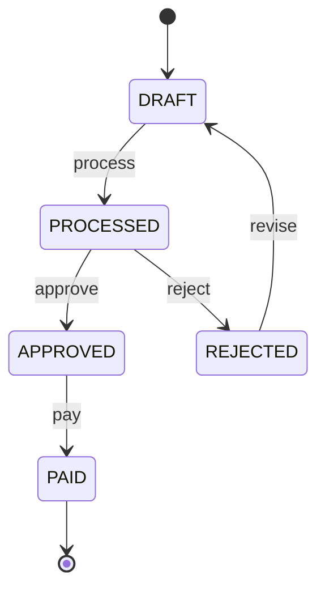

# State Transition: Payroll Run (Rule R15)

**What it is:** The payroll run moves through states. We test the **valid** moves and check that **invalid** moves are blocked.

| State \ Event | process | approve | reject | revise | pay |
|---|---|---|---|---|---|
| **DRAFT** | PROCESSED | ❌ | ❌ | ❌ | ❌ (TC_ST_04) |
| **PROCESSED** | ❌ | APPROVED | REJECTED | ❌ | ❌ |
| **APPROVED** | ❌ | ❌ | ❌ | ❌ | PAID |
| **REJECTED** | ❌ | ❌ | ❌ | DRAFT | ❌ |
| **PAID** (final) | ❌ (TC_ST_06) | ❌ | ❌ | ❌ (TC_ST_05) | ❌ |

| TC ID | Scenario | Test Data | Expected Result |
|---|---|---|---|
| TC_ST_01 | DRAFT → process | process | State = PROCESSED |
| TC_ST_02 | Full valid path | process, approve, pay | State = PAID; history DRAFT→PROCESSED→APPROVED→PAID |
| TC_ST_03 | Reject and revise | process, reject, revise | REJECTED, then DRAFT |
| TC_ST_04 | Invalid: pay a DRAFT run | pay (from DRAFT) | Error; state stays DRAFT |
| TC_ST_05 | Invalid: revise a PAID run | process, approve, pay, revise | Error; state stays PAID |
| TC_ST_06 | Invalid: process a PAID run | process, approve, pay, process | Error |
