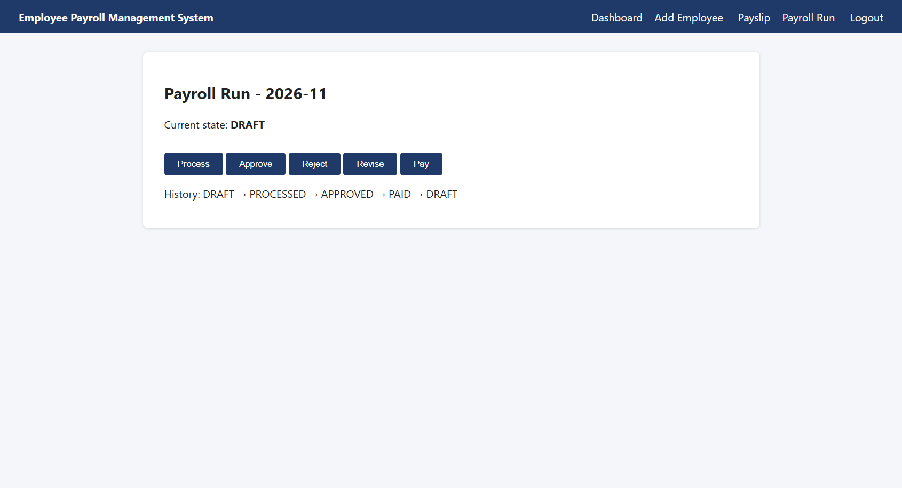
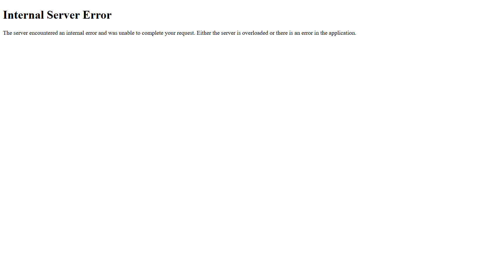

# Defect Report

**6 defects found** | Critical: 1 | Major: 4 | Minor: 1

| Severity | Meaning |
|---|---|
| Critical | Wrong salary paid to many employees |
| Major | Wrong result or crash in an important feature |
| Minor | Small validation issue, salary not affected |

| ID | Title | Severity | Found by | Status |
|---|---|---|---|---|
| DEF-01 | Overtime of 61 hours is accepted (limit is 60) | Major | TC_BVA_06 | Open |
| DEF-02 | PF is not capped at Rs 1,800 for basic above 15,000 | Critical | TC_BVA_10, TC_FN_04 | Open |
| DEF-03 | Professional Tax not deducted when gross is exactly 25,000 | Major | TC_BVA_11 | Open |
| DEF-04 | A PAID payroll run can be revised back to DRAFT | Major | TC_ST_05 | Open |
| DEF-05 | Employee name with only spaces is accepted | Minor | TC_EP_04 | Open |
| DEF-06 | Years of Service / Rating not validated: text crashes the page, rating 9 accepted | Major | TC_EP_05, TC_EP_06 | Open |

---

## DEF-01: Overtime of 61 hours is accepted (limit is 60)

| Field | Details |
|---|---|
| Module | Payslip |
| Rule violated | R7 |
| Severity / Priority | **Major** / High |
| Found by | TC_BVA_06 |
| Status | Open |

**Steps to reproduce:** 1. Login as admin 2. Open Payslip, select an employee 3. Enter Overtime Hours = 61 4. Click Generate

**Expected:** Error: 'Overtime hours must be between 0 and 60'

**Actual:** Payslip generated with 61 hours of overtime pay (Rs 12,200)

**Cause:** `Application_Under_Test/payroll.py` line 66: Upper-limit check uses `hours > MAX_OT_HOURS + 1`, so 61 is allowed

**Suggested fix:** Use `hours > MAX_OT_HOURS`
---
## DEF-02: PF is not capped at Rs 1,800 for basic above 15,000

| Field | Details |
|---|---|
| Module | Payslip |
| Rule violated | R9 |
| Severity / Priority | **Critical** / High |
| Found by | TC_BVA_10, TC_FN_04 |
| Status | Open |

**Steps to reproduce:** 1. Add a Permanent employee with basic 30000, 3 yrs, rating 4 2. Generate payslip with OT 10, LOP 2

**Expected:** PF = 1800, Net = 46000

**Actual:** PF = 3600, Net = 44200. Every employee with basic above 15,000 is underpaid

**Cause:** `Application_Under_Test/payroll.py` line 81: PF is calculated on the full basic; the PF_WAGE_CEILING constant is never used

**Suggested fix:** Use `round(min(basic, PF_WAGE_CEILING) * PF_RATE, 2)`
---
## DEF-03: Professional Tax not deducted when gross is exactly 25,000

| Field | Details |
|---|---|
| Module | Payslip |
| Rule violated | R10 |
| Severity / Priority | **Major** / Medium |
| Found by | TC_BVA_11 |
| Status | Open |

**Steps to reproduce:** 1. Add employee with basic 16000 2. Generate payslip with OT 5 hrs (gross = 25000)

**Expected:** Professional Tax = 200

**Actual:** Professional Tax = 0

**Cause:** `Application_Under_Test/payroll.py` line 86: Uses `>` instead of `>=` (off-by-one at the boundary)

**Suggested fix:** Use `gross >= PT_THRESHOLD`
---
## DEF-04: A PAID payroll run can be revised back to DRAFT

| Field | Details |
|---|---|
| Module | Payroll Run |
| Rule violated | R15 |
| Severity / Priority | **Major** / High |
| Found by | TC_ST_05 |
| Status | Open |

**Steps to reproduce:** 1. Login, open Payroll Run 2. Click Process, Approve, Pay (state = PAID) 3. Click Revise

**Expected:** Error message; state stays PAID (PAID is final)

**Actual:** State changes to DRAFT. History shows PAID → DRAFT, so salaries could be paid twice

**Cause:** `Application_Under_Test/payroll.py` line 145: Extra `elif` allows `revise` from PAID

**Suggested fix:** Remove the `elif` branch; only the TRANSITIONS table should decide

**Screenshot:**

---
## DEF-05: Employee name with only spaces is accepted

| Field | Details |
|---|---|
| Module | Employee |
| Rule violated | R11 |
| Severity / Priority | **Minor** / Medium |
| Found by | TC_EP_04 |
| Status | Open |

**Steps to reproduce:** 1. Open Add Employee 2. Enter Name = '   ' (3 spaces), other fields valid 3. Click Save

**Expected:** Error: 'Employee name is required'

**Actual:** Employee saved with an empty name

**Cause:** `Application_Under_Test/payroll.py` line 47: The regex allows spaces only, and the name is not trimmed before checking

**Suggested fix:** Strip the name first, then check it is not empty
---
## DEF-06: Years of Service / Rating not validated: text crashes the page, rating 9 accepted

| Field | Details |
|---|---|
| Module | Employee |
| Rule violated | R13 |
| Severity / Priority | **Major** / High |
| Found by | TC_EP_05, TC_EP_06 |
| Status | Open |

**Steps to reproduce:** 1. Open Add Employee 2. Enter valid data but Years = abc 3. Click Save (also: Rating = 9 is saved)

**Expected:** Validation error shown on the form

**Actual:** '500 Internal Server Error' page. Rating 9 is saved with no error

**Cause:** `Application_Under_Test/app.py` line 109: `float()`/`int()` are used directly with no validation; ValueError is not caught

**Suggested fix:** Add validate_years() and validate_rating() functions that raise ValidationError

**Screenshot:**

