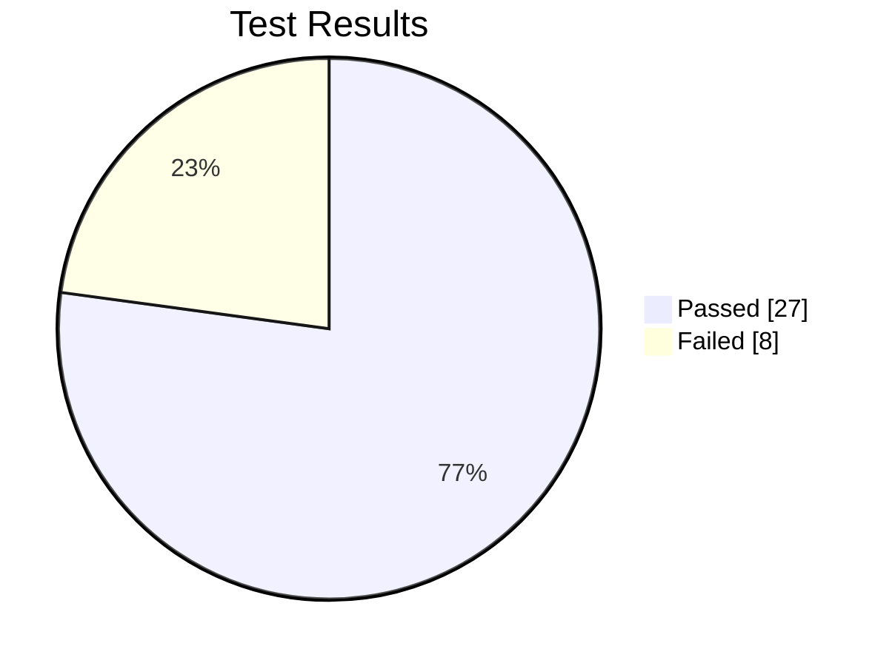

# Test Summary Report

**Project:** Employee Payroll Management System | **Date:** 12-11-2026 | **Team:** Prisha Kulkarni, Rajeshwari

## Overall result

| Total | Passed | Failed | Pass % | Defects |
|---|---|---|---|---|
| 35 | 27 | 8 | **77.1%** | **6** |

## By technique

| Technique | Total | Passed | Failed | Defects found |
|---|---|---|---|---|
| Equivalence Partitioning | 7 | 4 | 3 | DEF-05, DEF-06 |
| Boundary Value Analysis | 12 | 9 | 3 | DEF-01, DEF-02, DEF-03 |
| Decision Table | 6 | 6 | 0 | - |
| State Transition | 6 | 5 | 1 | DEF-04 |
| Functional | 4 | 3 | 1 | DEF-02 |

## By tool

| Tool | Tests | Passed | Failed |
|---|---|---|---|
| pytest | 27 | 22 | 5 |
| Selenium | 8 | 5 | 3 |

## Defects

| ID | Title | Severity |
|---|---|---|
| DEF-01 | Overtime of 61 hours is accepted (limit is 60) | Major |
| DEF-02 | PF is not capped at Rs 1,800 for basic above 15,000 | Critical |
| DEF-03 | Professional Tax not deducted when gross is exactly 25,000 | Major |
| DEF-04 | A PAID payroll run can be revised back to DRAFT | Major |
| DEF-05 | Employee name with only spaces is accepted | Minor |
| DEF-06 | Years of Service / Rating not validated: text crashes the page, rating 9 accepted | Major |

## Observations

- **Boundary Value Analysis found the most defects** (DEF-01, DEF-02, DEF-03). All three are mistakes exactly at a limit (`> 60 + 1`, `>` instead of `>=`, missing cap).
- **State Transition testing** found that a PAID payroll can be reopened (DEF-04), which could lead to paying salaries twice.
- **Selenium** found a crash (DEF-06) that is only visible through the website, because the bug is in the web form handling, not in the calculation code.
- The Decision Table tests all passed, so the bonus logic is correct.

## Conclusion

The application is **not ready for release**: one Critical defect (DEF-02, wrong PF for most employees) and four Major defects are open. After the fixes, all 35 tests should be re-run (regression testing).

**Full HTML report from pytest:** [test_report.html](test_report.html) (download and open in a browser)
