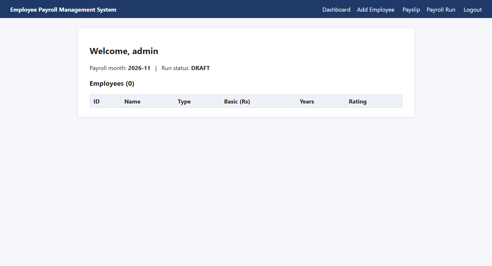
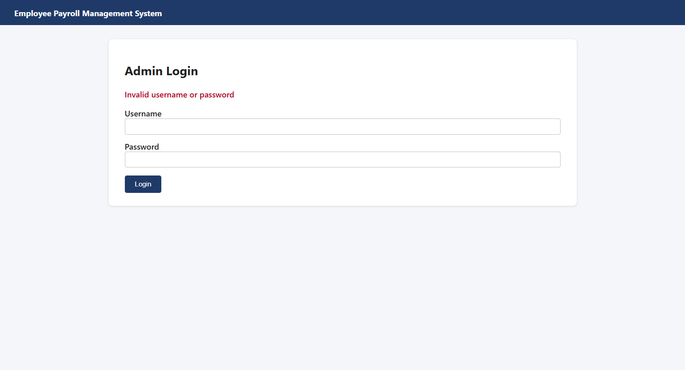
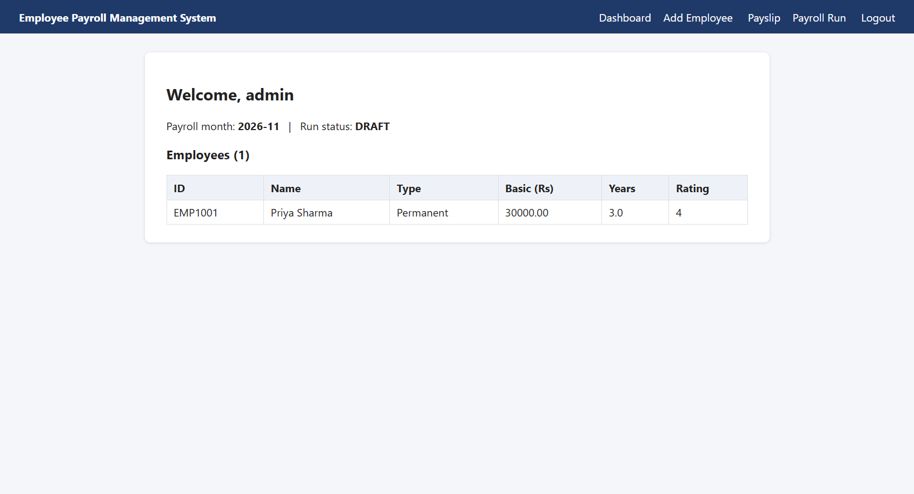
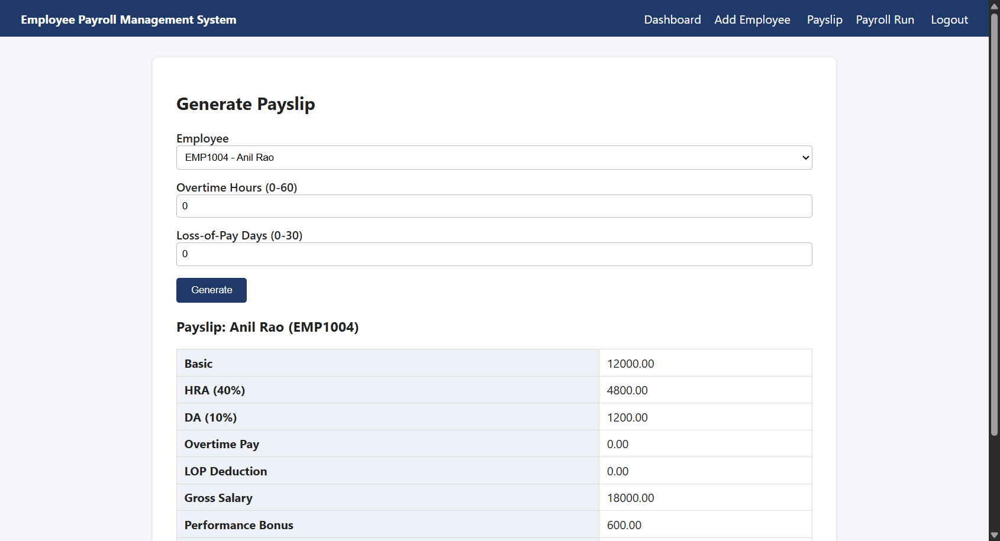
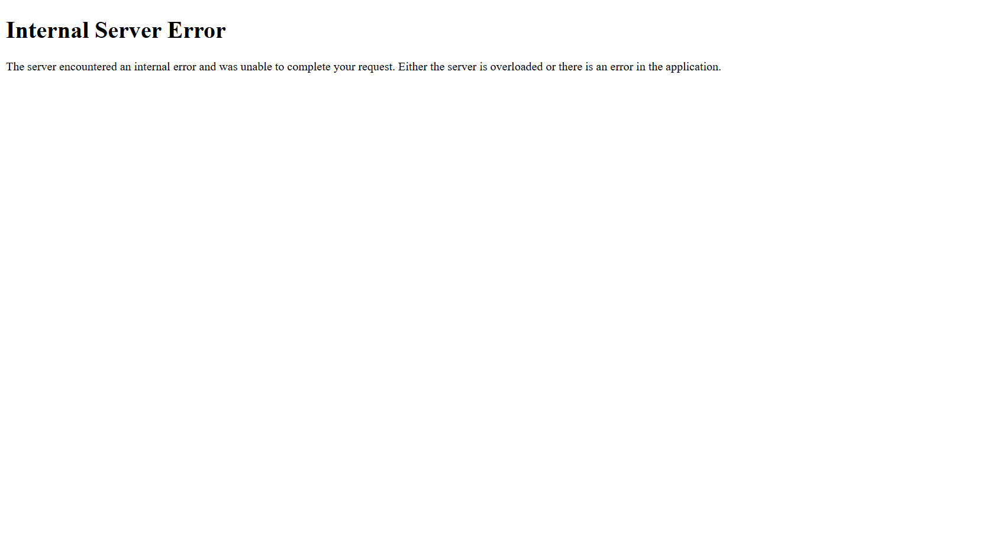
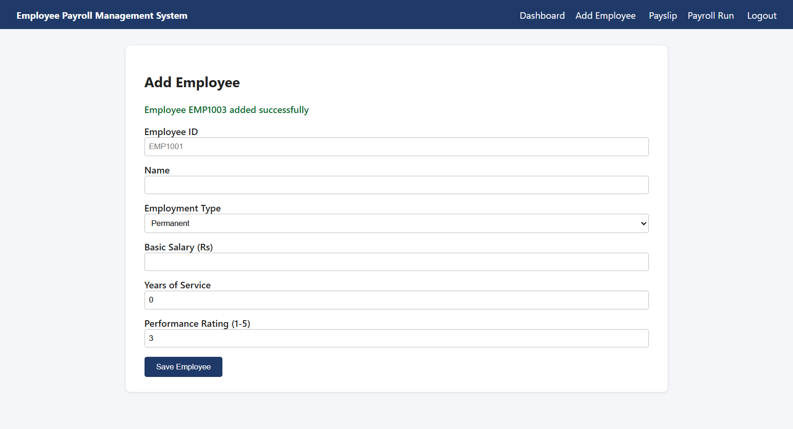
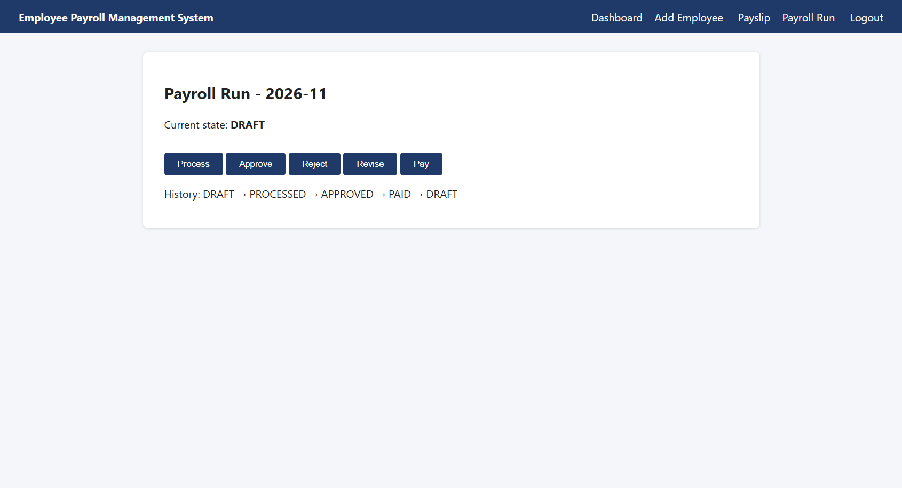

# Screenshots

## Taken automatically by Selenium (`selenium/` folder)

| Screenshot | Test | Result |
|---|---|---|
|  | TC_FN_01: valid login opens dashboard | ✅ Pass |
|  | TC_EP_07: wrong password shows error | ✅ Pass |
|  | TC_EP_01: add valid employee | ✅ Pass |
|  | TC_FN_03: payslip generated correctly | ✅ Pass |
|  | TC_EP_05: "abc" in Years crashes the page | ❌ Fail (DEF-06) |
|  | TC_EP_06: rating 9 is saved | ❌ Fail (DEF-06) |
|  | TC_ST_05: PAID run revised to DRAFT | ❌ Fail (DEF-04) |

## To add manually

| File name | What to capture |
|---|---|
| `01_pytest_terminal.png` | Terminal after `pytest -v` showing 27 passed, 8 failed |
| `02_html_report.png` | `06_Test_Reports/test_report.html` opened in the browser |
| `03_test_execution_excel.png` | `Test_Execution.xlsx` with Pass/Fail colours |
| `04_github_commits.png` | GitHub commit history page |
